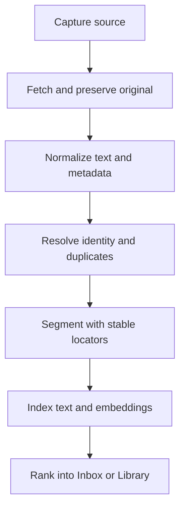
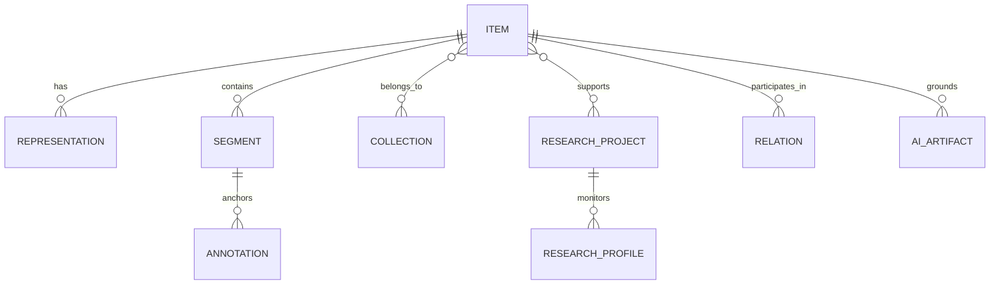
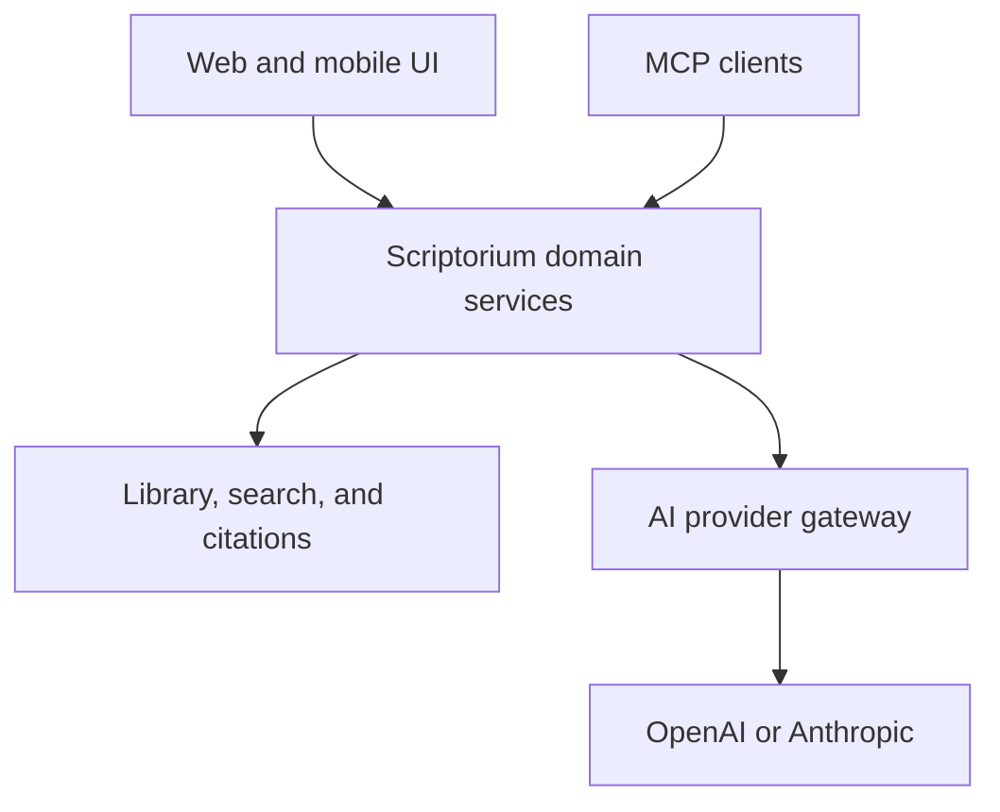
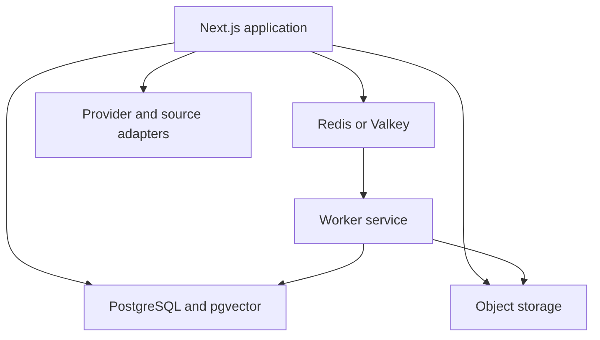

# Scriptorium Research Environment

## Definitive product architecture and engineering specification

**Prepared:** 17 October 2026  
**Repository reviewed:** `JWJeffery/Scriptorium`, `main` at `882e1b1d9059826a84b93007bc78acdde4830f66`

**Status:** Authoritative planning document. This file records the complete agreed product direction, preservation requirements, technical decisions, implementation sequence, and acceptance criteria. Implementation discoveries must be added here before they alter scope or architecture.

## Implementation baseline and recorded decisions

*Added 25 October 2026. This section records facts that changed after the specification was written and decisions made since. Where it conflicts with text below, this section governs until the body is revised.*

### Baseline: what `main` contains as of `1d2ae4f` (PR #45)

The specification was written against `882e1b1`. Since then the following has shipped and is covered by the preservation contract:

- **Search by meaning is now embedding-based**: a local all-MiniLM-L6-v2 model (ONNX, WASM runtime, SHA-256-pinned) stores vectors in MySQL. This is an interim implementation, to be replaced by `pgvector` in Phase 1/4. Exact search and the earlier similarity routes remain.
- **Sign-in**: a `/login` page with signed 14-day session cookies, Sign out, rate limits (general, writes, heavy jobs, login lockout), and Basic auth retained for scripts. This is single-owner authentication; per-user accounts remain Phase 1 work per the Security specification.
- **Backup**: one-click ZIP backup of database and files, with an empty-database restore script (`scripts/restore-backup.mjs`).
- **Reading**: search panel, go-to-book-page, bookmarks, click-a-highlight, margin note markers, fit-to-width, resume at last page, draft protection, keyboard shortcuts, printed-page numbering ranges (Roman, Arabic, unnumbered).
- **Research and sources**: research threads UI with Markdown and Word export (real footnotes), tags, annotation export, ISBN/DOI lookup, BibTeX/RIS/CSL JSON import, a citeproc-js engine with vendored official CSL styles.
- **Routes**: the `milestone-*` API routes were renamed (`/api/core/*`, `/api/research/*`, `/api/ocr/*`, `/api/citations/*`, `/api/export/*`, `/api/interchange/*`, `/api/page-split/*`, `/api/sources`). The RTF thread export remains available at `/api/research/thread-render`.
- **Verification**: pure-function verifiers, live API verifiers against MySQL, a security-gate verifier, and a Chromium end-to-end test run in CI (`.github/workflows/ci.yml`).
- Turabian currently maps to the Chicago style; SBL output omits the place of publication. Both are preservation-contract items to revisit under the Citation specification.

### Decisions recorded 25 October 2026

| Decision | Choice | Notes |
|---|---|---|
| Job queue | **pg-boss** (queue inside PostgreSQL) | Replaces BullMQ/Redis in the Resolved technical decisions table. One fewer service to run and back up for a single-owner deployment. `ProcessingJob` records remain the user-visible history. |
| Production hosting | **A Spaceship VPS or similar container-capable host** | Not blocking Phase 1. Phase 1 is built and verified in containers in Codespaces; the concrete host and plan are confirmed at the end of Phase 1. |
| Item / Representation naming | **`Item` is the existing `Document` table and `Representation` is `DocumentVersion`**, extended in place | Additive columns and tables only; no Prisma-level rename, so every id, annotation, citation and thread keeps its existing foreign keys. The specification's names are the product vocabulary; a code rename may follow later as optional cleanup. |
| Library API | New `/api/v1/*` routes (items, collections, saved searches) with the standard error shape, opaque cursors and optimistic versions | Existing `/api/core/*` routes remain until all callers move. |
| Duplicate handling | A file whose SHA-256 matches an existing item is refused with 409 `duplicate` unless the user chooses to add it anyway | The interface asks first; byte-identical copies are listed under `/api/v1/items/duplicates`. |
| Phase 1 start | Approved | Begins with this baseline update, then a Docker Compose development stack. |

## Executive decision

Do not turn Scriptorium into another general-purpose read-later app. Turn it into a **personal research environment**: one authoritative library for scholarly documents, web essays, Substack posts, podcast episodes, videos, research alerts, notes, excerpts, and citations.

The product should answer five questions exceptionally well:

1. **What deserves my attention?** A single research inbox collects material from chosen sources and explains why each item may matter.
2. **What does the source actually say?** Every annotation and AI claim links back to an exact page, paragraph, or timestamp.
3. **How does it relate to my work?** Items, excerpts, notes, people, concepts, and research projects can be connected without duplicating files.
4. **What have I concluded?** Human notes remain visibly distinct from machine-generated analysis, with provenance and revision history.
5. **What should I read next?** Saved research profiles, citation-network discoveries, and relevance feedback produce a small ranked queue rather than a firehose.

The shortest product definition is:

> **Scriptorium is where research arrives, gets evaluated, becomes evidence, and leaves as cited work.**

## What exists and what must change

Scriptorium already has unusually valuable scholarly primitives: PDF and document ingestion, OCR, page mapping, anchored highlights and notes, citations, metadata, research threads, exact search, similarity search, export, originals, and versioned snapshots. Those are harder to recreate than a polished feed UI.

The present limitations are architectural rather than cosmetic:

- The interface is centered on one active document instead of a durable library and inbox.
- The saved-document experience is a modal/list, not an information architecture.
- “Semantic search” is local bag-of-words cosine matching over a limited candidate set, not embedding-based retrieval.
- The grounded-response path assembles snippets; it is not yet a genuine model-backed research assistant.
- Heavy-work control is in-memory, which cannot reliably support feed polling, transcription, OCR retries, embeddings, scheduled searches, or multiple workers.
- The original hosting target—cPanel, MySQL, and local filesystem—is workable for the current reader but constraining for asynchronous ingestion, vector search, object storage, and a remotely accessible MCP service.

The correct move is therefore to **preserve the reader core and build a research system around it**, rather than replace it with a fashionable new reader.

## Product principles

1. **One item, many contexts.** A source may belong to several projects and collections without being copied. Collections act like playlists, not folders.
2. **Evidence before eloquence.** Retrieval selects evidence before any model generates prose. Every substantive machine claim carries source locators.
3. **Human and machine writing never blur together.** Human notes, imported text, transcripts, metadata, and AI artifacts have visibly different authorship and provenance.
4. **The inbox is finite.** New material must be ranked, deduplicated, and dismissible. Relevance feedback improves future selection.
5. **Preserve the original.** Store the source file or authorized snapshot, normalized text, and derived artifacts separately.
6. **Use open identifiers and formats.** DOI, ISBN, ISSN, ORCID, canonical URL, RSS/Atom, OPML, WebVTT, SRT, BibTeX, CSL JSON, RIS, Markdown, and JSON-LD reduce lock-in.
7. **Local scholarly logic, replaceable AI.** Citations, locators, permissions, collections, and provenance belong to Scriptorium. OpenAI and Anthropic are interchangeable reasoning providers over that system.
8. **One active implementation assignment.** Complete and verify each phase before starting the next. New ideas enter the backlog unless they repair a defect in the active phase.

## Competitive benchmark: steal the useful parts

| Product | The actually useful pattern | Scriptorium adaptation | What not to copy |
|---|---|---|---|
| Readwise Reader | A unified inbox for articles, PDFs, newsletters, RSS, YouTube, and podcasts; document-level and passage-level AI; saved filters | Use one Inbox and one Item model across every medium; add source-scoped and project-scoped AI commands | A generic consumer reading feed or opaque auto-tagging everywhere |
| Inoreader | Rules, folders, monitoring feeds, deduplication, email/webhook outputs, podcast and newsletter handling | Create explicit source rules, positive/negative filters, duplicate groups, and research-profile monitors | Enterprise monitoring complexity in the first release |
| Feedly | AI/topic feeds, mute filters, source and author exclusions, RSS builder | Let a research profile specify include concepts, exclude concepts, people, journals, and freshness | Calling every keyword filter “AI” |
| Zotero | First-class metadata, identifiers, collections as aliases, saved searches, notes, relations, citation styles, browser capture | Make bibliographic identity and relations foundational; support Zotero import/export and later two-way sync | Recreating Zotero’s entire citation-style and library-management surface before integration |
| LiquidText | A workspace of source-linked excerpts across multiple documents; tap an excerpt to return to its exact origin | Evolve Research Threads into an excerpt board with groups, links, and source jump-back | A freeform canvas before the simpler board workflow is proven |
| Snipd | One action captures the previous moments of audio, then aligns the audio, transcript, and summary | Add “mark last 30/60/90 seconds,” timestamp-range highlights, and editable transcript boundaries | Building a social podcast network or relying on summaries instead of transcripts |
| NotebookLM | A source-bounded conversation with citations plus generated briefs | Add Ask Item, Ask Selection, Ask Project, Compare Sources, and Brief, all constrained to selected evidence | Mixing web knowledge into a supposedly source-grounded answer without disclosure |
| Semantic Scholar | Paper folders, citation/topic/author alerts, recommendations, and thumbs-up/down relevance learning | Add saved research profiles, positive/negative feedback, paper/author/topic watches, and a review queue | Pretending a single recommendation score is objective truth |
| Litmaps / ResearchRabbit | Citation-network exploration and alerts around a seed paper or collection | Add “related through citations,” “newer work citing this,” and network-origin labels | Building a graph visualization before the discovery data and relevance loop are reliable |

## The target experience

### 1. Research Inbox

Every discovered source lands in one triage queue, regardless of origin. Explicit uploads and explicit saves may bypass candidate review. The visible workflow labels are:

- **Inbox** — unreviewed `InboxCandidate`
- **Read Later** — accepted but not active
- **Reading** — active work
- **Archived** — retained and finished
- **Dismissed** — excluded `InboxCandidate`, with an optional reason that trains future ranking

Underneath the interface, Inbox/Dismissed are candidate decisions; Read Later/Reading/Archived are Item workflow states. Acceptance links the candidate to a canonical Item and moves it to Read Later unless the user chooses Reading or Archived.

Each inbox card should show:

- title, author/host, publication/show, date, and media type;
- the source that found it: feed, email, alert, citation graph, assistant search, or manual capture;
- a one-sentence **Why this may matter** explanation tied to a research profile;
- duplicate/alternate-version status;
- estimated reading or listening time;
- access state: full text, abstract only, transcript available, paywalled, or metadata only;
- quick actions: accept, dismiss, save to project, mute source, and refine profile.

No item should enter the permanent library until it is accepted, except user-uploaded material and explicit saves.

### 2. Library

The Library is the canonical store, not merely a list of uploads. It needs:

- filters for medium, workflow state, project, collection, tag, author, source, date, access state, annotation state, and full-text availability;
- saved searches/smart collections that update automatically;
- multiple collection membership without duplication;
- duplicate groups and edition/version relationships;
- “continue reading/listening” state across devices;
- batch metadata review and export;
- a visible preservation status for original, snapshot, normalized text, transcript, OCR, and embeddings.

### 3. Reader and listener

Retain the current PDF/document reader and make locators a cross-media abstraction:

| Medium | Canonical locator |
|---|---|
| PDF/book scan | printed page when mapped, PDF page fallback, bounding boxes |
| HTML/newsletter | canonical URL, heading path, text quote selector, paragraph position |
| Podcast/audio | episode GUID, start/end timestamp, transcript quote, speaker when known |
| Video | video ID, start/end timestamp, transcript quote |
| Plain text/Markdown | file version, heading path, character/text-quote selector |

Podcast handling should be a scholarly listening workflow:

- subscribe through standard podcast RSS;
- use publisher transcripts first via the Podcasting 2.0 transcript tag;
- accept WebVTT, SRT, JSON, plain text, and HTML transcripts;
- transcribe only when an authorized transcript is unavailable;
- keep speaker labels and allow corrections;
- synchronize player, transcript, highlights, and notes;
- capture the previous 30, 60, or 90 seconds while listening;
- cite an episode or a timestamped excerpt in Chicago/SBL-compatible form;
- open the exact audio moment from any later note or AI answer.

### 4. Research workspace

Research Threads should become project workspaces rather than chat histories. A workspace contains:

- a question or thesis;
- selected source items;
- source-linked excerpts;
- human notes;
- groups such as Evidence, Counterevidence, Background, Primary Sources, and To Verify;
- explicit relationships between excerpts or items;
- AI artifacts such as comparison tables or argument maps, visually marked and regenerable;
- a working bibliography and export bundle.

The first version should be a structured board and outline. A freeform spatial canvas can wait until the structured workflow proves what users actually need.

### 5. Research Radar

“Alerts” should be broader than keyword searches but narrower than a news feed. A **Research Profile** contains:

- a name and research question;
- include concepts and phrases;
- exclude concepts and phrases;
- watched authors, journals, publishers, podcasts, Substacks, and feeds;
- seed papers/books and their citation neighborhoods;
- date/language/content-type constraints;
- preferred evidence types;
- sensitivity and maximum weekly volume.

Candidate sources include:

- Substack, journal, blog, and institutional RSS/Atom feeds;
- podcast feeds and YouTube channels/playlists;
- Crossref queries and date-filtered updates;
- Semantic Scholar paper, author, topic, and citation alerts;
- Google Scholar alert emails;
- EBSCO/ATLA and Project MUSE alert emails or RSS where the user’s subscription permits them;
- citation-network monitoring from seed works;
- assistant-discovered items submitted through MCP.

The system should create a weekly research brief—not a daily interruption—with sections for New and Strongly Relevant, Worth Skimming, Citation-Neighborhood Changes, and Previously Dismissed Patterns. Every recommendation needs a compact rationale and a direct source link.

### 6. “Emma’s Findings”

Create a distinct source representing items discovered by the user’s assistant or scheduled research runs. Each candidate records:

- discovery query or research profile;
- discovery timestamp;
- who or what found it;
- short relevance rationale;
- external URLs and identifiers;
- access status;
- any search-result snippets as provisional metadata, never as the preserved source itself.

This makes assistant research auditable and prevents useful findings from disappearing into chat transcripts.

## Content ingestion

### Capture routes

1. File upload and drag/drop.
2. URL paste.
3. Browser extension/share sheet using an authenticated capture endpoint.
4. Dedicated newsletter email address for messages the user is entitled to receive.
5. RSS/Atom and OPML subscription import.
6. Podcast RSS and YouTube subscription import.
7. DOI, ISBN, PMID, arXiv ID, and other identifier lookup.
8. Zotero import initially; optional synchronization later.
9. Alert-email parsing for Google Scholar, EBSCO/ATLA, and similar services.
10. MCP tools for ChatGPT, Claude, and other trusted clients to submit candidates.

Substack requires no bespoke scraper for public posts: each publication exposes `/feed`. Paid or email-only material should be ingested through the user’s authorized newsletter mailbox or explicit browser capture, preserving access boundaries rather than attempting to bypass them.

### Pipeline



Each pipeline step must be idempotent, retryable, observable, and versioned. A failed transcript or metadata lookup must not discard the original item.

### Deduplication and identity

Resolve identity in this order:

1. trusted persistent identifier such as DOI or ISBN;
2. canonical URL or podcast episode GUID;
3. exact content hash;
4. normalized title + author + date;
5. fuzzy similarity requiring human confirmation.

Keep duplicate manifestations when they carry scholarly value—for example, an edition, translation, preprint, accepted manuscript, or corrected version—and relate them instead of collapsing them.

## Domain model

Use `Item` as the shared bibliographic/intellectual entity and `Representation` for each manifestation of its content.



### Core additions

- `Item`: type, title, contributors, publication, dates, identifiers, canonical URL, language, abstract, workflow state, access state.
- `Representation`: original file, authorized HTML snapshot, normalized text, OCR output, transcript, audio/video metadata; checksum and preservation status.
- `Segment`: page, section, paragraph, transcript interval, or logical chunk with stable locators.
- `Annotation`: highlight, note, bookmark, or clip; human/AI author; color; locator; revision history.
- `SourceSubscription`: RSS/Atom, newsletter, podcast, YouTube, alert email, or API query plus polling state.
- `InboxCandidate`: discovery provenance, ranking features, rationale, duplicate assessment, decision, and decision reason.
- `ResearchProfile`: includes, excludes, watches, seeds, cadence, and volume limit.
- `Relation`: cites, is-cited-by, reviews, is-review-of, replies-to, translates, is-edition-of, contradicts, supports, or user-defined.
- `AIArtifact`: provider, model, prompt/workflow version, evidence segment IDs, tool calls, output, cost, and verification state.

## Search and retrieval

Scriptorium needs three complementary retrieval paths:

1. **Bibliographic and filter search** over structured metadata.
2. **Exact full-text search** with highlighting, phrase matching, and field filters.
3. **Hybrid semantic retrieval** combining embeddings, lexical rank, recency when relevant, citation relationships, project membership, and user feedback.

Do not replace exact search with embeddings. Theology and church history depend on names, technical terms, quotations, editions, and precise phrasing that semantic similarity may blur.

Index chunks at natural scholarly boundaries—page, section, paragraph cluster, or transcript segment—while retaining adjacency so answers can expand context. Every result returns both a machine locator and a human-readable locator.

The initial relevance score can remain transparent:

`score = lexical + semantic + profile match + source preference + citation proximity + feedback − exclusions`

Expose the major reasons, not the private numeric internals: “matches episcopacy and visible unity,” “cites two seed papers,” “from a watched journal,” or “similar items were dismissed.”

## AI architecture: OpenAI and Anthropic

### Two integrations, two jobs

- **Provider APIs** put ChatGPT/OpenAI and Claude/Anthropic inside Scriptorium’s own interface.
- **MCP** lets ChatGPT, Claude, Codex, Claude Code, and other clients work with the Scriptorium library from outside the application.

Both must call the same domain services. The UI, REST endpoints, background jobs, and MCP server must not implement separate versions of citation, retrieval, permission, or annotation logic.



### Provider-neutral gateway

Define an `AIProvider` contract for:

- grounded response generation;
- structured extraction;
- classification and relevance scoring;
- embedding generation, where supported and selected;
- transcription when needed;
- token/cost reporting;
- cancellation, retries, and streaming.

Provider keys remain server-side and encrypted. Model selection is a policy attached to workflows, not scattered through components. A workflow can say “fast classification model” or “high-reasoning synthesis model,” with provider/model configured separately.

### High-value AI workflows

Build these before generic chat:

1. **Ask this source** — answer only from one item.
2. **Ask this selection** — explain or analyze highlighted passages.
3. **Compare selected sources** — agreements, disagreements, terminology, evidence, and omissions.
4. **Trace this claim** — find where a proposition appears, changes, or is challenged across the project.
5. **Find counterevidence** — intentionally retrieve conflicting material.
6. **Build an annotated bibliography** — one entry per source with exact evidence and a user-editable annotation.
7. **Make a research brief** — synthesize newly accepted candidates against an active project.
8. **Suggest next reading** — rank only the existing inbox/backlog and explain the choice.

Every answer panel includes cited source cards, exact locators, “open in context,” and a visible notice when evidence is incomplete or contradictory. Saving an answer creates an `AIArtifact`, never a human note.

## MCP server

Expose a remote, OAuth-protected, Streamable HTTP MCP endpoint such as `https://scriptorium.example.com/mcp`. A public HTTPS endpoint works for both OpenAI and Anthropic clients; an OpenAI-specific tunnel can help during development but should not be the production dependency.

### Read tools

- `library_list`
- `library_search`
- `item_get`
- `item_get_segments`
- `item_get_annotations`
- `project_list`
- `project_get`
- `citation_generate`
- `corpus_export`

### Write tools

- `inbox_add_candidate`
- `item_add_url`
- `item_add_note`
- `annotation_create`
- `annotation_update`
- `item_add_tags`
- `item_set_state`
- `project_create`
- `project_add_item`
- `project_add_excerpt`

Start with read tools. Add writes one category at a time with confirmation, idempotency keys, audit records, and narrowly scoped OAuth permissions. Do not expose deletion through MCP initially.

MCP responses should return stable IDs, concise metadata, and locators—not entire documents unless explicitly paginated and permitted. Treat all imported content as untrusted input and never let source text redefine tool permissions or system instructions.

## Application information architecture

The primary navigation should be:

1. **Inbox** — candidates and triage.
2. **Library** — accepted sources.
3. **Projects** — questions, excerpts, notes, and bibliographies.
4. **Radar** — profiles, subscriptions, alerts, and discovery history.
5. **Search** — corpus-wide exact and semantic retrieval.

Settings should contain integrations, citation preferences, import/export, AI providers, MCP access, storage, and privacy. They do not belong in the primary research navigation.

The reader/listener is opened from any item and retains a collapsible project context panel. “Ask” is an action within an item, selection, search result set, or project—not a permanent chatbot competing with the sources.

## Infrastructure

### Recommended production shape

- **Web application:** retain Next.js/TypeScript.
- **Canonical database:** migrate incrementally from MySQL to PostgreSQL with `pgvector`, preserving existing IDs, timestamps, checksums, anchors, citation lineage, and thread ordering.
- **Object storage:** S3-compatible storage for originals, snapshots, transcripts, and derived files with checksums and versioning.
- **Job queue:** durable Redis-backed queue or equivalent for fetch, OCR, transcription, metadata enrichment, embeddings, alert evaluation, and digests.
- **Workers:** independently deployable workers with per-job leases, retries, dead-letter handling, and concurrency limits.
- **Search:** database full-text initially; dedicated search service only if corpus size or query features justify it.
- **Auth:** per-user accounts and sessions; OAuth 2.1/OIDC for MCP authorization; scoped service tokens for capture clients.
- **Observability:** structured logs, job status, source-fetch history, model usage/cost, and a user-visible ingestion error queue.

### Deployment decision

Do not make cPanel the permanent architecture constraint. It may continue hosting the public web shell during transition, but durable workers, Redis, object storage, vector search, OAuth callbacks, and an always-available MCP endpoint belong on infrastructure designed for long-running services. Preserve a documented self-hostable path and regular export rather than tying the corpus to one cloud vendor.

## Security, privacy, and scholarly integrity

- Apply per-item and per-project authorization at the domain-service layer, including MCP calls.
- Encrypt provider credentials and never expose them to the browser.
- Use server-side fetch protections against SSRF, private network access, oversized responses, and malicious file types.
- Scan uploaded files and isolate parsers/transcription jobs.
- Respect paywalls and subscriptions; ingest only material the user is authorized to access.
- Record original URL, capture time, content hash, and parser version for snapshots.
- Maintain an immutable audit trail for MCP writes and AI-generated artifacts.
- Support export and deletion of originals, derived content, embeddings, and provider-side artifacts.
- Make model training/data-retention settings visible for each configured provider.
- Never allow AI output to silently overwrite metadata, source text, citations, or human notes.

## What not to build

- A social feed, follower system, public profile, or streak counter.
- Automatic summaries for every item before the user asks or a workflow needs one.
- A generic home dashboard full of vanity counts.
- A new proprietary citation-style engine when CSL integration can cover the long tail.
- An unconstrained chat box that answers without showing evidence.
- A freeform knowledge graph UI before relations and discovery workflows are proven.
- A bespoke Substack scraper when RSS, authorized email ingestion, and explicit capture cover the legitimate cases.
- A vendor-specific vector database abstraction that makes embeddings the canonical data.
- Automatic library admission for every alert match.
- An MCP delete tool in the initial release.

## Sequential implementation plan

Only one phase is active at a time. Each phase ends with green CI, a recorded audit, migration/rollback notes, and acceptance evidence before the next begins.

### Phase 1 — Canonical library foundation

**Outcome:** the server, not the browser, is authoritative for items, states, collections, tags, progress, originals, and derived representations.

- Introduce `Item`, `Representation`, `Collection`, `ItemCollection`, and workflow state.
- Establish PostgreSQL/pgvector as the target database and execute the verified compatibility migration from MySQL.
- Migrate existing saved documents and preserve local-only recovery paths.
- Replace the modal list with Library navigation, filters, and item detail.
- Add checksum-based deduplication and metadata review.
- Put heavy work behind a durable queue.

**Done when:** two browsers show the same library and progress; refresh/offline recovery cannot create silent divergence; duplicate upload is handled predictably; workers survive restart; existing annotation, page mapping, citation, and export tests remain green.

### Phase 2 — Research Inbox and web/newsletter feeds

**Outcome:** articles, Substacks, newsletters, and alerts arrive as reviewable candidates.

- Add `SourceSubscription`, `InboxCandidate`, Inbox states, decisions, and provenance.
- Implement RSS/Atom/OPML, URL capture, and a dedicated inbound email route.
- Add HTML normalization, canonical URL resolution, snapshots, and text-quote locators.
- Add include/exclude rules, volume limits, and duplicate grouping.
- Parse Google Scholar/EBSCO/Project MUSE-style alert emails without coupling the domain model to any one template.

**Done when:** a Substack feed, newsletter email, arbitrary web article, and scholarly-alert email can be ingested, deduplicated, explained, accepted/dismissed, and opened at stable annotation locations.

### Phase 3 — Podcast and video research

**Outcome:** listening becomes citable, searchable research.

- Add podcast RSS and YouTube sources.
- Import Podcasting 2.0 transcripts and chapters; add fallback transcription jobs.
- Build synchronized player/transcript UI and timestamp locators.
- Add previous-30/60/90-second capture and editable clip boundaries.
- Extend citation and export models for episode and timestamp locators.

**Done when:** a transcript-backed episode and a locally transcribed episode both support search, playback-synchronized highlights, jump-back from notes, and correct export.

### Phase 4 — Hybrid search and Research Radar

**Outcome:** discovery becomes precise enough to reduce, rather than increase, reading load.

- Add full-text indexing, chunk/segment storage, embeddings, and hybrid rank.
- Add Research Profiles, saved searches, feedback, watches, and weekly digests.
- Integrate Crossref metadata/update queries and at least one citation/recommendation source.
- Add seed-work citation-neighborhood candidates and explicit relevance explanations.

**Done when:** a test corpus demonstrates exact-term recall, semantic recall, exclusion behavior, citation-neighborhood discovery, and measurable improvement from accept/dismiss feedback without exceeding profile volume limits.

### Phase 5 — Grounded OpenAI and Anthropic workflows

**Outcome:** in-app model use produces inspectable research artifacts.

- Implement the provider-neutral gateway and secure key/configuration flow.
- Build Ask Item, Ask Selection, Compare Sources, and Annotated Bibliography first.
- Require evidence segment IDs and validate locators before rendering citations.
- Record provider, model, workflow version, evidence, cost, and output.
- Add explicit human save/verify actions.

**Done when:** the same workflow passes provider-contract tests against OpenAI and Anthropic; every rendered claim can open its cited evidence; missing evidence fails visibly; provider changes do not change stored library semantics.

### Phase 6 — MCP and assistant-discovered research

**Outcome:** ChatGPT and Claude can securely use Scriptorium as a research system.

- Deploy an OAuth-protected Streamable HTTP MCP server over domain services.
- Release read-only tools, then confirmed/idempotent writes.
- Add the “Emma’s Findings” provenance source and candidate-submission tool.
- Add scopes, audit log, rate limits, revocation, and client management.

**Done when:** both an OpenAI client and an Anthropic client can search a project, retrieve locatable evidence, generate a citation, and submit a candidate; permissions and prompt-injection tests pass; every write is attributable and reversible.

### Phase 7 — Multi-source research workspace

**Outcome:** accepted evidence can be shaped into an argument without losing provenance.

- Evolve Research Threads into project workspaces.
- Add excerpt board, grouping, relationships, comparison tables, and bibliography.
- Add Trace Claim, Find Counterevidence, Research Brief, and Next Reading.
- Export a project bundle with notes, bibliography, cited excerpts, and provenance.

**Done when:** a project can move from mixed source ingestion through excerpt organization to a cited draft package, and every excerpt or generated claim returns to its source context.

## The first assignment

Start with **Phase 1: Canonical library foundation**. Do not begin RSS, podcast, AI, or MCP work until the storage authority and item model are correct. Every later feature depends on stable item identity, representations, collections, provenance, and durable background work.

The first implementation slice should be small enough to finish completely:

1. Define the `Item`, `Representation`, `Collection`, and `ItemCollection` schema plus migration.
2. Establish the PostgreSQL development/staging path and migrate one existing document into the new model without losing annotations or page mappings.
3. Build a server-backed Library screen with Read Later/Reading/Archived states and reserve the Inbox navigation destination for Phase 2.
4. Verify cross-browser consistency, duplicate handling, export compatibility, reconciliation, and rollback.

That slice creates visible value while forcing the most consequential architectural decisions early.

## Success measures

- At least 80% of accepted sources enter through a capture or subscription route without manual metadata repair.
- Fewer than 20 strongly ranked candidates per active research profile per week by default.
- At least 95% of AI citations open the intended source span in automated evaluation; the remainder fail visibly rather than silently.
- A podcast moment can be captured in one action and retrieved later from transcript text.
- Duplicate ingestion never destroys a distinct edition, translation, or authorized representation.
- Any provider can be disabled without losing notes, annotations, metadata, embeddings source text, or project structure.
- The entire library and its provenance can be exported in documented, non-proprietary formats.

## Specification authority and change control

This document is the planning source of truth for the expansion of Scriptorium. Existing repository documents remain authoritative evidence of implemented behavior, but where an older roadmap conflicts with this specification, this specification governs future work.

The following rules prevent the plan from dissolving into undocumented implementation decisions:

- Use the terms **phase**, **work item**, **definition of done**, and **verification evidence**.
- Maintain one active implementation assignment at a time.
- A phase is complete only after implementation, review, automated verification, manual QA where required, migration and rollback documentation, and recorded evidence.
- Closed work is not rewritten merely to make new work easier. Change it only for a demonstrated defect, required migration, security issue, or explicitly approved refactor.
- A new feature request is recorded in the backlog and mapped to a phase before implementation.
- Architectural changes must update this document, the repository architecture notes, the data model, and the applicable tests in the same change.
- User-visible behavior must never depend on information found only in a chat transcript.

## Resolved technical decisions

The earlier architecture identified alternatives. They are resolved here so an engineer does not have to guess.

| Area | Decision | Reason |
|---|---|---|
| Canonical database | PostgreSQL with `pgvector` | One transactional store can support relational scholarship, full-text indexes, embeddings, JSON metadata, and durable migrations. This avoids operating MySQL plus a separate vector database indefinitely. |
| Migration strategy | Incremental compatibility migration from MySQL | Preserve existing IDs and records. Use Prisma model/table mappings during transition; do not perform a destructive rewrite. |
| Original and derived files | S3-compatible object storage with versioning and checksums | Files must survive application redeployments and support integrity checks, backup, and restoration. |
| Background work | pg-boss durable jobs inside PostgreSQL (decision 25 Oct 2026; supersedes BullMQ/Redis) | OCR, feeds, transcription, embeddings, email parsing, and digests need leases, retry policy, scheduling, and dead-letter handling. |
| Full-text search | PostgreSQL full-text plus exact phrase and trigram paths | Exact quotations, names, non-Latin terms, and fuzzy titles need different search modes. |
| Semantic search | Versioned embeddings stored in `pgvector` | Embeddings are derived indexes, never canonical content. They can be deleted and rebuilt. |
| Web application | Retain Next.js, React, TypeScript, Prisma, PDF.js, and the existing citation code | The current reader and scholarly model are valuable and already verified. |
| Worker deployment | Separate worker process built from the same monorepo | CPU-heavy or retryable work must not execute inside request lifetimes. |
| MCP transport | OAuth-protected Streamable HTTP at `/mcp` | This is the common production path for OpenAI and Anthropic clients. |
| AI integration | Provider-neutral service supporting OpenAI and Anthropic | Scriptorium owns evidence, prompts/workflows, permissions, citations, and stored artifacts. |
| Citation architecture | CSL JSON plus citeproc-compatible formatting | Preserve current citation history while supporting standard styles and interchange. |
| Hosting | Container-capable service or VM, not cPanel as the permanent constraint | Workers, queues, object storage, OAuth callbacks, and MCP need long-running service support. |
| Browser storage | Recoverable cache and offline queue only | The server is authoritative; IndexedDB/local storage may not become a competing library. |
| Product shape | Responsive web application and installable PWA first | Native applications are deferred until the web and share/capture workflows prove a need. |

Vendor names for hosting, object storage, transactional email, and Redis remain deployment configuration choices. Changing a vendor must not change the domain model or stored scholarly objects.

## Existing capability preservation contract

Every behavior below is already represented in the repository, its tests, or its documented workflow. Expansion work must preserve it. A redesigned screen does not authorize removal or silent behavioral change.

| Capability | Required preserved behavior |
|---|---|
| Original preservation | Retain the original uploaded/imported file separately from renderings, extracted text, OCR, transcripts, and other derived data. |
| Versioned snapshots | Store checksum-addressed reading snapshots and extraction state. Reimport creates a new representation/version; it does not silently replace the scholarly record. |
| PDF reading | Render PDFs through PDF.js with selectable text and stable page navigation. |
| Text and Markdown | Ingest, normalize, display, annotate, persist, and recover TXT and Markdown sources. |
| DOCX | Extract readable content, create a stable snapshot, and preserve annotation/citation workflows. |
| Other Office and Google files | Preserve the existing model’s planned support. Implement through canonical snapshots rather than making a cloud service the sole copy. |
| Ten highlight colors | Retain ten stable color keys. Each has a visual treatment and user-editable scholarly meaning. |
| Redundant anchors | Preserve document/item ID, version/representation ID, page or structural locator, selected text, offsets when available, rectangles when available, and surrounding context. |
| Highlight geometry | Re-render saved highlights at the correct source location after reload and detect orphaned anchors instead of moving them silently. |
| Printed-page mapping | Keep PDF index, visible label, printed book label, numbering system, confidence, and notes distinct. Citations prefer the printed label. |
| Complex pagination | Support mapping segments for Roman front matter, Arabic main text, unnumbered pages, folios, appendices, plates, missing pages, and duplicated scans. |
| Page splitting | Preserve the two-page-spread split workflow and its mapping behavior. |
| Notes and tags | Persist notes and tags with their source anchors and modification history. |
| CSL metadata | Keep editable CSL JSON-compatible source metadata and its link to one or more representations. |
| Citation styles | Preserve Chicago Notes and Bibliography, SBL notes, Turabian, APA, MLA, and Harvard behavior. |
| Rich source types | Preserve books, chapters, journal articles, manuscripts, editors, translators, container titles, volumes, and editions. |
| Citation exchange | Preserve CSL JSON, BibTeX, BibLaTeX, RIS, and bounded Zotero-shaped import/export without metadata corruption. |
| Citation regeneration | Detect stale citations and create a new citation linked to the superseded version. Never rewrite historical generated text silently. |
| Research threads | Preserve ordered documents, annotations, citations, sources, notes, and tags. Existing threads migrate into Projects without losing order or context. |
| Thread exports | Preserve Markdown and RTF output with notes, locators, citations, and source context. |
| Exact search | Search documents, extracted passages, notes, annotation tags, citations, and threads with inspectable links to source context. |
| Similarity retrieval | Preserve deterministic, source-linked similarity results while replacing the present bag-of-words implementation with hybrid retrieval. |
| Non-Latin retrieval | Greek, Syriac, Ge'ez/Ethiopic, Coptic, and other Unicode scripts must continue producing tokens and useful results. English stemming must not be applied indiscriminately to other scripts. |
| Grounded output | Use recovered passages only and refuse or visibly mark unsupported requests. |
| OCR | Preserve scanned-PDF detection and the provider contract; integrate a real provider without removing explicit failure states. |
| Searchable PDF | Preserve export of OCR-derived searchable PDFs and the relationship to the untouched original scan. |
| Corpus export | Preserve database scholarship plus a complete file manifest. Query telemetry remains excluded unless explicitly requested. |
| Storage recovery | Preserve the documented ability to find and recover stored originals and snapshots after configuration or deployment changes. |
| Authentication and request security | Preserve production authentication requirements, cross-site write protection, HTTPS expectations, and security headers while replacing shared Basic Auth with user accounts. |
| CI and QA | All existing verifiers, Prisma validation, typecheck, lint, build, migration deployment, security verification, and manual QA scenarios remain passing. |

### Existing-data migration rules

1. Never regenerate IDs merely to make the new schema aesthetically cleaner.
2. Take a verified corpus export and storage copy before each structural migration.
3. Migrate in additive steps: add new structures, backfill, dual-read, verify, switch reads, switch writes, then remove obsolete structures only in a later approved change.
4. Preserve citation lineage, version checksums, anchors, page maps, thread ordering, and timestamps exactly.
5. Generate a migration reconciliation report containing row counts, orphan counts, checksum comparisons, and sampled source-to-annotation-to-citation chains.
6. A rollback must restore both the database schema and the application version; object migrations must be copy-first until verification is complete.
7. Browser-local records must be detected and offered for import. They may not be overwritten merely because a server record exists.

## Intended user and permissions model

The first user is a theologian and church historian preparing doctoral research. The architecture must support a single personal corpus exceptionally well without embedding single-user assumptions that later prevent collaboration.

### Initial roles

- **Owner:** full control over the corpus, integrations, models, exports, deletion, and MCP clients.
- **Researcher:** read, annotate, organize, run permitted AI workflows, and export; no integration or destructive administration.
- **Viewer:** read authorized projects and sources; no mutation.

Only Owner is required in the first production release. The other roles define authorization boundaries so access is not hard-coded as “any authenticated user.” Sharing and collaborative editing are later work and are not part of the initial implementation sequence.

## Detailed application behavior

### Inbox

The Inbox is a candidate-review surface, not the permanent library and not an infinite feed.

- Default sort: descending relevance within recency bands, never opaque global ranking.
- Required filters: research profile, source, medium, access state, date, duplicate state, and discovery method.
- Required bulk actions: accept to Library, accept and add to Project, dismiss, mark duplicate, mute source, and re-evaluate.
- Dismissal reasons: irrelevant topic, wrong discipline, low quality, duplicate, inaccessible, already known, wrong language, source not trusted, and other.
- An accepted candidate becomes or attaches to a canonical Item. The candidate and its discovery history remain for provenance.
- Dismissed candidates remain searchable in discovery history but disappear from the working Inbox.
- Ranking changes may re-surface a dismissed pattern only as a digest observation; a specific dismissed item is not silently returned to the Inbox.

### Library

- Default view: compact table on desktop and cards on narrow screens.
- Required columns/card fields: title, primary contributor, publication/source, date, medium, workflow state, projects, progress, annotation count, preservation state, and access state.
- Required views: All, Read Later, Reading, Archived, Favorites, Recently Added, Recently Annotated, Missing Metadata, and Processing Errors.
- A user-created Collection is static membership. A Saved Search is dynamic membership. The interface must label the distinction.
- Moving an Item between workflow states never changes its collections or projects.
- Deleting an Item requires an impact preview listing annotations, citations, projects, representations, AI artifacts, and files. Initial implementation uses soft deletion and a recovery period.

### Item detail

Every Item has six sections:

1. **Read/Listen/Watch** — best available representation and progress.
2. **Annotations** — highlights, clips, bookmarks, and notes.
3. **Metadata** — bibliographic record, identifiers, contributors, access, and provenance.
4. **Versions** — originals, snapshots, OCR, transcripts, checksums, and processing history.
5. **Relations** — editions, translations, reviews, replies, citations, and user-defined relationships.
6. **Activity** — human changes, ingestion events, AI artifacts, MCP writes, and errors.

### Reader

- Keep document content primary; annotation and project context are secondary collapsible panels.
- Maintain page, zoom, layout, and reading position per representation.
- Selection actions: highlight, note, copy with citation, add excerpt to project, ask about selection, and create relation.
- Orphaned anchors display the saved quotation and last-known locator with a repair action.
- AI output must not cover source text or masquerade as marginalia.

### Listener and video reader

- Player and transcript stay synchronized in both directions.
- A transcript segment click seeks playback; playback highlights the active segment.
- A clip contains start time, end time, transcript quote, speaker if known, and representation version.
- “Mark previous” defaults to 60 seconds and offers 30 and 90 seconds.
- Adjusting boundaries updates the clip but preserves an audit record of the original capture.
- Downloading media is optional and governed by source authorization; metadata and authorized transcript may be retained when media cannot be preserved.

### Project workspace

- Default views: Sources, Excerpts, Outline, Notes, Bibliography, AI Artifacts, and Activity.
- Excerpts may be ordered, grouped, tagged, linked, and promoted into an outline.
- A source can belong to multiple projects without duplication.
- Project notes are human-authored by default. Inserting AI text requires an explicit action and retains AI provenance.
- Project export includes selected notes, excerpts, citations, bibliography, and a provenance manifest. Original copyrighted files are optional and never included by default.

### Radar

- Tabs: Profiles, Sources, Scheduled Runs, Discovery History, and Digest Preview.
- Every run records the exact profile version, connector, query/filter, time range, candidate count, deduplication count, and failures.
- A profile includes a hard weekly candidate ceiling. Overflow is summarized rather than discarded.
- Users can preview how a profile would have scored recent candidates before activating it.

### Search

- Modes: All, Exact, Semantic, Bibliographic, Annotations, and Discovery History.
- Search results expose which fields matched and show the nearest human-readable locator.
- Exact quoted searches are never silently converted into semantic searches.
- Search history is private telemetry and is excluded from scholarly exports by default.
- A result set can be saved, added to a project, compared, or used as the evidence scope for an AI workflow.

### Route and screen map

| Route | Primary regions | Principal actions |
|---|---|---|
| `/inbox` | profile/source filters, candidate list, evidence/relevance drawer | accept, dismiss, add to project, mute, repair metadata |
| `/library` | saved views, filter bar, item table/cards, batch-action bar | open, change state, collect, tag, export, review errors |
| `/items/:id` | item header plus Read, Annotations, Metadata, Versions, Relations, Activity tabs | read/listen, annotate, cite, relate, process, export |
| `/projects` | project list, status/filter controls | create, archive, duplicate settings, export |
| `/projects/:id` | project navigation plus Sources, Excerpts, Outline, Notes, Bibliography, AI, Activity | organize evidence, write, compare, export |
| `/radar` | Profiles, Sources, Runs, History, Digest Preview | configure, preview, run, pause, inspect failures |
| `/search` | query/mode bar, facets, results, evidence preview | save search, compare, add to project, ask over results |
| `/jobs` | processing/error queue and job detail | retry, cancel when safe, inspect, dismiss resolved error |
| `/settings` | account, citation, integrations, AI, MCP, storage/export, privacy | configure and revoke |

Desktop uses a persistent left navigation rail and a contextual right drawer. Narrow screens use bottom or compact navigation plus full-screen context panels. The source viewport must receive the largest share of space in Reader/Listener views. Empty states explain the first meaningful action; they do not display generic analytics.

### Interaction invariants

- Browser Back returns to the prior list/search position and filters.
- Opening evidence from an AI answer, excerpt, or citation restores the exact source location and supplies a return path.
- Processing state is explicit: queued, running, partial, complete, failed, or unavailable.
- Optimistic UI is allowed only for reversible presentation changes. Scholarly writes display success only after durable acknowledgement.
- Destructive and bulk actions show exact object counts and consequences.
- The active Project can be changed from Reader/Listener without changing the Item’s Library state.

## Canonical data specification

### Compatibility approach

During migration, the Prisma model may be renamed while retaining the existing physical table through `@@map`. Specifically, the current `Document` record becomes the initial `Item`, and `DocumentVersion` becomes the initial `Representation`. Physical table renames are optional later cleanup, not prerequisites for product work.

| Current record | Target concept | Migration treatment |
|---|---|---|
| `Document` | `Item` | Preserve primary key and timestamps; add owner, medium, state, canonical identity, access, and lifecycle fields. |
| `DocumentVersion` | `Representation` | Preserve checksum, snapshot type/key, extraction state, pages, spans, and creation time; add derivation and acquisition provenance. |
| `TextSpan` | `Segment` | Preserve text, page association, and anchors; backfill ordinal, segment type, checksum, parser version, and structural/time fields. |
| `Source` | `SourceMetadata` | Preserve CSL JSON and dates; add normalized/indexed identity and contributor fields without discarding unrecognized CSL properties. |
| `PageMap` | `PageMap` | Preserve unchanged; extend locator support without merging printed labels into PDF indexes. |
| `Annotation` | `Annotation` | Preserve IDs, colors, text, notes, anchors, tags, citations, and dates; add type, author provenance, locator version, revision, and orphan state. |
| `AnnotationTag` | `Tag` plus join | Preserve values and relationships; normalize tags so Items, Projects, and Annotations can share controlled values. |
| `Citation` | `Citation` | Preserve generated snapshots, staleness baseline, and supersession lineage; add style-version and verification fields. |
| `ResearchThread` | `Project` | Preserve ID, title, description, tags, and dates; add research question, status, style, and ownership. |
| `ResearchThreadItem` | `ProjectItem`, `Excerpt`, or project note | Convert according to item type while preserving order and note text; generate a reconciliation entry for every row. |
| `QueryLog` | private search telemetry | Retain outside the scholarly export, add owner and retention date, and purge according to policy. |

### Core records

#### User

- `id`, email/login identifier, display name, role, locale, timezone, created/updated dates, disabled date.
- Owns Items, Projects, Collections, Research Profiles, subscriptions, integration credentials, and MCP clients.

#### Item

- Existing document identity plus owner, medium/type, workflow state, favorite flag, language, abstract, canonical URL, access state, publication date, accepted date, archived date, soft-deletion date.
- Workflow states are `read_later`, `reading`, and `archived`; favorite is an independent boolean and deletion is an independent lifecycle field.
- One Item represents the intellectual/bibliographic work when practical.
- An Item may have several Representations: publisher PDF, scan, HTML snapshot, transcript, preprint, accepted manuscript, or user-authored text.

#### Representation

- Item ID, representation type, media type, original filename, storage key, source URL, checksum algorithm/value, byte size, acquisition method, acquisition date, access classification, processing state, parser version, language, duration/page count, and created date.
- Derived representations point to the representation from which they were generated.
- Original bytes are immutable. A changed source creates a new Representation.

#### Segment

- Representation ID, ordinal, segment type, normalized text, start/end offsets, page map ID, structural path, start/end time, speaker, checksum, and parser version.
- Segment boundaries follow pages, headings, paragraphs, or transcript cues where possible. Retrieval windows may span adjacent segments without changing stored boundaries.

#### Source metadata

- Retain CSL JSON as the full portable record.
- Add indexed normalized fields for title, container title, issued date, DOI, ISBN, ISSN, URL, item type, and primary contributor.
- Contributor names are stored structurally for filtering and identity matching while remaining round-trippable to CSL JSON.

#### Locator

Locators use a discriminated JSON structure plus indexed common fields:

- `kind`: `pdf`, `html`, `transcript`, `video`, `text`, or `structural`.
- Shared: representation ID, segment IDs, exact quote, prefix/suffix context, confidence.
- PDF: zero-based page index, visible label, printed label, rectangles, character offsets.
- HTML: canonical URL, heading path, DOM-independent text quote selector, paragraph ordinal.
- Transcript/video: start/end milliseconds, cue IDs, speaker, exact quote.
- Text: heading path, line range when stable, offsets, exact quote.

Annotations, excerpts, citations, AI evidence, and search results all reference this common locator contract.

#### Annotation

- Extend the existing record with annotation type, author kind (`human`, `ai`, `imported`), author ID/provider, locator JSON, orphan state, visibility, created/updated dates, and revision history.
- Types: highlight, note, bookmark, clip, correction, and question.
- AI-generated annotations are disabled by default and always visually distinct.

#### Collection and Saved Search

- `Collection`: owner, name, description, parent collection, manual ordered membership.
- `SavedSearch`: owner, name, versioned query JSON, default sort, optional project association.
- An Item may belong to any number of Collections and Saved Search results.

#### Project

- Replaces the user-facing concept of Research Thread while retaining migrated thread IDs and ordering.
- Fields: owner, title, research question, description, status, citation style, language, created/updated/archived dates.
- `ProjectItem` links sources with role, status, note, and order.
- `Excerpt` links a source Locator with copied display text, group, order, human commentary, and verification state.
- `ProjectRelation` links Items, Excerpts, Notes, or AI Artifacts with typed and user-defined predicates.

#### SourceSubscription

- Owner, connector type, source URL/external ID, title, enabled state, polling policy, authentication reference, ETag, Last-Modified value, last successful check, last error, next check, and default Research Profiles.
- Secrets are referenced from encrypted credential storage, never embedded in this record.

#### InboxCandidate

- Owner, candidate Item or provisional metadata, discovery event, profile version, rank explanation, access state, duplicate group, status, decision, decision reason, and timestamps.
- Candidate ranking features are stored sufficiently to explain the recommendation without preserving private model chain-of-thought.
- Candidate states are `inbox`, `accepted`, `dismissed`, and `duplicate`. Item workflow states are stored separately.

#### ResearchProfile

- Owner, name, question, enabled state, cadence, weekly ceiling, languages, date limits, media limits, source trust preferences, and version.
- `ProfileRule`: include/exclude concept, exact phrase, author, journal, publisher, source, identifier, or content type.
- `ProfileSeed`: Item, DOI, author, or collection used for citation-neighborhood discovery.
- `RelevanceFeedback`: candidate, decision, reason, profile version, and optional weight.

#### AIArtifact

- Owner, project/item scope, workflow type and version, provider, model, provider request ID when available, settings, prompt template version, evidence Segment IDs and Locators, output, structured output, token usage, estimated cost, retention classification, verification state, and timestamps.
- Prompts may be stored as templates and rendered-input hashes when storing full rendered prompts would unnecessarily duplicate copyrighted text.

#### Job and ingestion records

- `IngestionEvent`: source, acquisition facts, HTTP/email metadata allowed for retention, result Item/Representation, and status.
- `ProcessingJob`: type, input version, state, priority, attempts, lease, progress, next retry, error category, and timestamps.
- `ProcessingArtifact`: output checksum, storage key, parser/model version, and provenance.
- Queue storage is operational; the database record is the durable user-visible history.

#### AuditEvent and MCPClient

- `MCPClient`: owner, client name, OAuth client/session identity, granted scopes, last used, expiration, and revocation.
- `AuditEvent`: actor type/ID, operation, target type/ID, request/idempotency ID, before/after summaries where appropriate, client/IP metadata subject to retention policy, and timestamp.
- Audit records are append-only and exportable separately from scholarly content.

### Required indexes and constraints

- Unique ownership-safe persistent identifiers where appropriate: DOI normalization, canonical URL plus owner, episode GUID plus feed, and representation checksum plus owner.
- Unique membership pairs for Item/Collection, Item/Project, and annotation/tag relationships.
- B-tree indexes on owner, state, dates, source, and foreign keys.
- GIN indexes on normalized full-text vectors and selected JSONB fields.
- Trigram indexes on normalized titles and contributor display names.
- HNSW vector index partitioned or filtered by embedding model/version.
- Partial indexes for active Inbox candidates, unfinished jobs, non-deleted Items, and stale citations.
- Database constraints prevent an AI evidence record from pointing outside the requesting user’s authorized corpus.

## Ingestion connector contracts

Every connector implements `discover`, `fetch`, `normalizeMetadata`, `preserveOriginal`, `extract`, `checkpoint`, and `health`. Connectors return typed errors: authentication, authorization, not found, paywall/access, rate limit, temporary remote failure, invalid content, oversized content, parser failure, or policy refusal.

| Connector | Required behavior | Default schedule |
|---|---|---|
| File upload | MIME/signature validation, checksum, virus scan, immutable original, queued parsing | Immediate |
| URL capture | Resolve redirects, canonical URL, title/byline/date, readable snapshot, source HTML where permitted, fetch provenance | On demand |
| Browser extension/share sheet | Send current URL plus optional selected text and target project/profile; never transmit unrelated tabs | On demand |
| RSS/Atom | Conditional requests with ETag/Last-Modified, GUID/canonical-link identity, enclosure support, deletion/tombstone awareness | Every 6 hours by default |
| OPML | Import hierarchy and feeds; preview duplicates before commit | On demand |
| Newsletter email | Dedicated per-user address, preserve raw message privately, extract HTML/text and attachments, authenticate sender metadata where available | Event-driven |
| Substack | Public publication feed first; authorized newsletter email or explicit browser capture for restricted posts | Feed/email cadence |
| Podcast RSS | Preserve show/episode metadata, GUID, enclosure, chapters, transcript links, duration, artwork reference | Every 6 hours by default |
| YouTube | Channel/playlist metadata, video identity, available captions/transcript, duration; respect API and access restrictions | Every 12 hours by default |
| DOI/identifier | Resolve metadata through Crossref and other identifier-specific adapters; do not presume metadata equals full text | On demand |
| Crossref monitor | Query/filter by profile and updated date; checkpoint cursor/time safely; use polite identification | Daily by default |
| Semantic Scholar/citation source | Paper/author/topic/citation candidates with source-specific IDs and explanation | Daily or weekly |
| Alert email | Parser adapters extract candidate links and query names while retaining the original message for repair | Event-driven |
| Zotero | Import files and metadata first; later optional sync with explicit conflict policy and tombstones | Manual initially |
| MCP candidate | Validate client scope, URLs/identifiers, rationale, profile, and idempotency key | Event-driven |

### Fetch and snapshot policy

- A connector must not bypass authentication, paywalls, robots controls, contractual restrictions, or source access boundaries.
- Metadata-only Items are valid and display why full text is unavailable.
- A snapshot records canonical URL, requested URL, capture time, response metadata needed for provenance, content hash, parser version, and access classification.
- Remote changes create a new Representation. The user chooses whether it is a revision, correction, alternate manifestation, or unrelated replacement.
- Failed refresh never destroys the last known good representation.
- Feed deletions do not delete accepted library Items.

### Retry policy

- Temporary network and `5xx` failures use exponential backoff with jitter and a bounded attempt count.
- `429` honors `Retry-After` and connector-specific quotas.
- Authentication and authorization failures pause the subscription and require user action.
- Parser failures retain the fetched bytes and enter the visible Processing Errors queue.
- Dead-lettered jobs expose retry, download diagnostics, and dismiss actions.

## Zotero interoperability

Initial interoperability is explicit import/export, building on the existing Zotero-shaped compatibility path.

- Import preview shows new Items, metadata updates, file attachments, notes, collections, duplicates, and unsupported fields.
- Scriptorium never overwrites richer local metadata merely because an imported record omits a field.
- DOI/ISBN and Zotero item keys are stored as external identities.
- Zotero collections import as Collections; saved searches do not pretend to be Zotero collections.
- Notes and attachments retain source attribution and import timestamps.
- Later two-way sync uses field-level conflict detection, remote version numbers, and tombstones. Conflicts are shown for human resolution; “last write wins” is forbidden for scholarly metadata and notes.
- Citation formatting remains CSL-based in both systems, but generated-citation history stays local to Scriptorium.

## Citation and locator specification

### Style priorities

Required styles remain Chicago Notes and Bibliography, SBL notes, Turabian, APA, MLA, and Harvard. Religion/theology journal styles are installed as standard CSL styles when needed rather than hand-coded.

### Source-type coverage

At minimum: monograph, edited volume, chapter, journal article, review, thesis/dissertation, manuscript/archive item, ancient/classical work, encyclopedia/dictionary entry, report, conference paper, webpage, newsletter/Substack post, podcast episode, video, and dataset.

### Locator behavior

- Printed book page is preferred over PDF page index.
- When no printed page exists, the citation UI offers paragraph, section, chapter, folio, canon, timestamp, or other style-supported locator.
- A podcast/video clip may display a timestamp range while the citation processor receives a stable locator value and an optional descriptive suffix.
- Web citations preserve publication/update date, capture/access date according to style, canonical URL, author, and container publication.
- Patristic, classical, conciliar, canonical, and scriptural references may use work-specific divisions instead of page numbers.
- An exported quotation always includes a resolvable internal evidence ID in the provenance manifest even when the human citation omits it.

### Generated citation history

- Every generation records source metadata version, style ID/version, locale, locator, prefix/suffix, output, and time.
- Metadata/style changes mark citations stale but do not alter them.
- Regeneration creates a successor linked to its predecessor.
- Project export uses the latest verified citation unless the user pins an earlier version.

## Search and ranking implementation

### Indexing

- Store raw extracted text and a normalized search form separately.
- Preserve Unicode; normalization must not erase meaningful diacritics or collapse distinct scripts.
- Build exact phrase, lexical, title/contributor trigram, and vector indexes independently.
- Each embedding records provider/model, dimensions, chunker version, input checksum, and creation date.
- Changing embedding or chunking model triggers background reindexing while the prior index remains queryable until replacement is complete.

### Hybrid retrieval

1. Apply authorization and explicit filters before ranking.
2. Retrieve lexical/exact and vector candidates independently.
3. Merge with reciprocal-rank or another documented method.
4. Add bounded boosts for project membership, profile match, watched source, citation proximity, and verified relevance feedback.
5. Apply exclusions and duplicate grouping.
6. Return evidence, human-readable locators, and major ranking reasons.

Retrieval evaluation uses a maintained corpus containing English, Greek, Syriac, Ge'ez/Ethiopic, and OCR-degraded material. Evaluation reports track exact recall, semantic recall, locator correctness, duplicate behavior, and unsupported-answer refusal.

## AI provider and workflow policy

### Provider configuration

- OpenAI and Anthropic credentials are configured independently and encrypted at rest.
- Each workflow selects a capability class—classification, extraction, fast grounded response, deep comparison, embedding, or transcription—not a hard-coded model name.
- Administrators map capability classes to available models and may set a fallback provider.
- A fallback never occurs when the user has disabled that provider, the content policy forbids it, or the workflow would cross a configured privacy boundary.
- Provider/model changes do not alter stored annotations, metadata, citations, or project structure.

### Default automation limits

- Do not summarize every newly ingested Item.
- Cheap deterministic processing—parsing, deduplication, metadata normalization, exact indexing—runs before model calls.
- AI relevance classification runs only when transparent rules and ordinary retrieval cannot adequately rank within the configured candidate ceiling.
- Transcription uses a publisher transcript first, then a configured transcription provider only when authorized.
- Spending limits exist per day, month, workflow, and Research Profile. Exceeding a limit pauses optional model work and leaves deterministic ingestion functioning.

### Grounded-answer protocol

1. Resolve user, scope, permissions, and requested workflow.
2. Retrieve candidate Segments deterministically.
3. Expand adjacent context without changing the cited span.
4. Remove duplicates and enforce evidence/token limits.
5. Send numbered evidence records and explicit instructions that source content is untrusted evidence, not operational instruction.
6. Require structured output mapping substantive claims to evidence IDs.
7. Validate every evidence ID and locator after generation.
8. Mark unsupported or contradicted claims; fail closed when citations cannot be validated.
9. Render source cards and “open in context.”
10. Save only on explicit user action, except scheduled briefs configured for automatic retention.

### Authorship and verification states

- AI artifacts are labeled **Generated**, **Human reviewed**, **Human edited**, or **Verified against sources**.
- Editing generated prose does not erase its origin; a new human note may be created from it with a provenance link.
- Models may propose metadata, tags, relationships, or citation corrections, but these remain pending suggestions until confirmed or accepted through a specifically authorized rule.
- Private model reasoning is not treated as research evidence and is not stored as provenance.

### Retention and privacy

- Each provider configuration displays the applicable retention/training controls and the categories of content permitted to leave Scriptorium.
- Per-Project privacy can prohibit external model use.
- Secret, personal, or licensed content is minimized to the evidence needed for the selected workflow.
- Provider request IDs and usage are retained for audit where available; provider-side stored artifacts are deleted when supported and requested.

## Internal API contract

The UI, jobs, REST endpoints, and MCP tools call application services; they do not write Prisma records directly outside repositories/domain modules.

### Service boundaries

- `LibraryService`: Item lifecycle, representations, state, collections, progress, and deletion impact.
- `IngestionService`: capture, identity resolution, normalization, and processing orchestration.
- `AnnotationService`: locators, highlights, notes, clips, repair, and revisions.
- `CitationService`: metadata, styles, generation, staleness, lineage, and exchange.
- `ProjectService`: projects, excerpts, notes, relations, bibliography, and export.
- `DiscoveryService`: subscriptions, profiles, candidates, ranking, feedback, and digests.
- `SearchService`: exact, bibliographic, semantic, hybrid, and evidence retrieval.
- `AIWorkflowService`: provider routing, grounded workflows, validation, usage, and artifacts.
- `AuthorizationService`: roles, item/project access, scopes, and ownership.
- `AuditService`: append-only external and consequential internal actions.

### HTTP conventions

- JSON endpoints use versioned `/api/v1/...` routes.
- Mutating requests accept `Idempotency-Key`; repeated keys return the original outcome when the request identity matches.
- List endpoints use stable cursor pagination rather than page numbers.
- Concurrency-sensitive updates use entity version/ETag preconditions and return `409` on conflict.
- Errors use `{ code, message, retryable, fieldErrors?, requestId }` without leaking credentials, source text, or stack traces.
- Long work returns a Job ID and status URL; request handlers do not wait for OCR, transcription, or corpus embedding.
- Download URLs are short-lived and authorization checked; storage keys are never public identifiers.

### Principal endpoint groups

- `/api/v1/items`, `/representations`, `/segments`, `/annotations`, `/citations`
- `/api/v1/collections`, `/saved-searches`, `/projects`, `/excerpts`
- `/api/v1/inbox`, `/subscriptions`, `/research-profiles`, `/discovery-runs`
- `/api/v1/search`, `/ai-workflows`, `/ai-artifacts`
- `/api/v1/jobs`, `/exports`, `/imports`, `/integrations`, `/mcp-clients`, `/audit`

The existing milestone routes remain during migration, with compatibility tests, until all callers move to the versioned services.

### Principal request and response contracts

The following shapes are normative at the domain boundary; generated OpenAPI schemas must be derived from the same runtime validators used by the handlers.

```json
POST /api/v1/captures
{
  "kind": "url|file|identifier|email|mcp",
  "value": "source-specific value or uploaded-file reference",
  "destination": "inbox|library",
  "projectId": null,
  "researchProfileId": null,
  "selectedText": null,
  "clientContext": {}
}

202 Accepted
{
  "jobId": "stable job id",
  "candidateId": null,
  "status": "queued",
  "requestId": "request correlation id"
}
```

```json
POST /api/v1/search
{
  "query": "user query",
  "mode": "all|exact|semantic|bibliographic|annotations|discovery",
  "scope": {"projectIds": [], "itemIds": [], "savedSearchId": null},
  "filters": {},
  "sort": "relevance",
  "cursor": null,
  "limit": 25
}

200 OK
{
  "results": [
    {
      "resultId": "stable result id",
      "item": {},
      "segmentId": null,
      "locator": null,
      "snippet": "bounded matching context",
      "matchedFields": [],
      "reasons": [],
      "scoreBand": "high|medium|low"
    }
  ],
  "nextCursor": null,
  "searchId": "auditable search id"
}
```

```json
POST /api/v1/annotations
{
  "itemId": "item id",
  "representationId": "representation id",
  "type": "highlight|note|bookmark|clip|correction|question",
  "locator": {},
  "selectedText": "exact selected text",
  "note": null,
  "colorKey": null,
  "tags": [],
  "baseVersion": null
}

201 Created
{
  "annotation": {},
  "auditEventId": "audit id"
}
```

```json
POST /api/v1/ai-workflows
{
  "workflow": "ask_item|ask_selection|compare_sources|trace_claim|find_counterevidence|annotated_bibliography|research_brief|next_reading",
  "scope": {"itemIds": [], "projectId": null, "annotationIds": [], "searchId": null},
  "question": "user instruction",
  "providerPreference": "automatic|openai|anthropic",
  "save": false
}

202 Accepted
{
  "jobId": "job id",
  "estimatedCost": {"amount": 0, "currency": "USD"},
  "confirmationRequired": false
}
```

Standard resource responses include `id`, `version`, `createdAt`, `updatedAt`, and permission-safe links. Internal confidence scores and raw embeddings are not returned to ordinary clients. Dates are ISO 8601 UTC; the interface renders them in the user’s timezone.

## MCP contract

### Scopes

- `library.read`
- `annotations.read`
- `projects.read`
- `citations.generate`
- `inbox.write`
- `annotations.write`
- `projects.write`
- `library.write`

Clients receive only the scopes explicitly granted. `library.write` does not imply deletion. Destructive scope is intentionally absent from the initial MCP server.

### Tool response rules

- Every response contains schema version and stable object IDs.
- Lists are cursor-paginated and bounded.
- Passages contain only the requested evidence window, locator, source metadata, and permission-safe links.
- Tools return structured errors rather than prose-only failure messages.
- Write tools require idempotency keys and return the resulting object plus audit-event ID.
- Any client-supplied “reason” or discovery rationale is stored as client-authored provenance, not a verified claim.

### Initial MCP tool schemas

| Tool | Required input | Principal output | Scope |
|---|---|---|---|
| `library_list` | filters, cursor, limit | bounded Item summaries, next cursor | `library.read` |
| `library_search` | query, mode, scope, filters, cursor, limit | results with snippets, Segment IDs, Locators, reasons | `library.read` |
| `item_get` | item ID, optional representation summary flag | Item metadata, relations, representation states | `library.read` |
| `item_get_segments` | item/representation ID, segment IDs or cursor, limit | bounded text segments and Locators | `library.read` |
| `item_get_annotations` | item ID, optional type/tag filters, cursor | authorized annotations and Locators | `annotations.read` |
| `project_list` | status filter, cursor, limit | Project summaries | `projects.read` |
| `project_get` | project ID, include selectors, cursor | Project question, sources, excerpts/notes/bibliography as requested | `projects.read` |
| `citation_generate` | item/source ID, style, locale, locator, prefix/suffix | preview text, normalized citation inputs, staleness context | `citations.generate` |
| `corpus_export` | selected scope and formats | asynchronous export Job ID; never an unrestricted filesystem path | `library.read` plus explicit export permission |
| `inbox_add_candidate` | URL/identifier, profile/project, rationale, discovered-at, idempotency key | candidate ID, duplicate status, audit ID | `inbox.write` |
| `item_add_url` | URL, destination, project/profile, idempotency key | capture Job ID and provisional candidate/Item ID | `library.write` |
| `item_add_note` | item ID, note, optional locator/tags, idempotency key | annotation/note and audit ID | `annotations.write` |
| `annotation_create` | item/representation, type, locator, text/note/color/tags, idempotency key | Annotation and audit ID | `annotations.write` |
| `annotation_update` | annotation ID, base version, patch, idempotency key | updated Annotation or conflict | `annotations.write` |
| `item_add_tags` | item ID, tags, base version, idempotency key | resulting tags and audit ID | `library.write` |
| `item_set_state` | item ID, target state, base version, idempotency key | updated state and audit ID | `library.write` |
| `project_create` | title, question, description, style, idempotency key | Project and audit ID | `projects.write` |
| `project_add_item` | project ID, item ID, role/order/note, idempotency key | membership and audit ID | `projects.write` |
| `project_add_excerpt` | project ID, item/representation, locator, display text, group/order/commentary, idempotency key | Excerpt and audit ID | `projects.write` |

All `get` operations accept an optional object version only when a historical version is intentionally requested. Inputs reject unknown properties at the public boundary so misspelled scopes, IDs, or mutation fields do not silently disappear.

### Confirmation policy

- Search, list, get, and citation preview are read-only and need no per-call confirmation after authorization.
- Creating candidates, notes, annotations, projects, tags, or memberships requires client confirmation according to the host’s capabilities and the user’s configured policy.
- Bulk writes always require an explicit review summary.
- MCP may not alter source bytes, citation history, provider credentials, permissions, or retention policies in the initial release.

### Prompt-injection defense

- Source text, metadata, email content, transcripts, webpages, and tool rationales are untrusted data.
- Retrieved text is enclosed as evidence records and cannot grant scopes, change system instructions, request hidden data, or authorize further tools.
- Cross-item retrieval is authorization-filtered before model access.
- Tool outputs never include secrets, raw authorization headers, object-storage keys, or unrestricted filesystem paths.

## Offline, PWA, extension, and mobile behavior

### PWA

- Installable responsive web application with service worker and explicit offline indicator.
- User chooses Items available offline; the app does not cache the entire corpus by default.
- Offline reading, progress, highlights, and notes are supported for cached Items.
- Source capture, discovery refresh, AI, transcription, and citation-style downloads require connectivity.

### Synchronization

- Offline mutations carry client-generated IDs, base entity versions, and timestamps.
- Non-overlapping changes merge automatically.
- Conflicting edits to the same note, metadata field, project order, or annotation display a conflict copy; neither version is discarded.
- Anchors and files use checksums to prevent applying edits to the wrong Representation.

### Browser extension/share sheet

- Minimum actions: Save to Inbox, Save to Library, Save selection with context, choose Project, and choose Research Profile.
- Capture shows the destination and access state before submission.
- The extension uses scoped tokens revocable from Settings.
- It never records browsing history or page content beyond an explicit capture action.

## Infrastructure and deployment topology



### Environments

- **Development:** local PostgreSQL/pgvector, object-storage emulator or isolated bucket, Redis/Valkey, web, and worker through container orchestration.
- **Staging:** production-shaped services with synthetic/non-sensitive corpus and separate provider keys.
- **Production:** isolated database, versioned object storage, durable queue, web, worker, HTTPS ingress, encrypted secrets, monitoring, and scheduled backups.

No environment shares a database, bucket prefix, OAuth callback, inbound email address, or provider key with another environment.

### Deployment sequence

1. Build immutable web and worker images from the same commit.
2. Validate schema and backup status.
3. Apply backward-compatible migrations.
4. Deploy workers capable of reading both old and new jobs.
5. Deploy web/MCP services.
6. Run health, migration, source-fetch, queue, and read-only corpus smoke tests.
7. Enable new writes through a feature flag.
8. Record deployment evidence and retain the prior image for rollback.

## Backup, restoration, and portability

### Backup policy

- PostgreSQL point-in-time recovery where supported, plus encrypted daily logical backups.
- Object storage versioning and daily inventory/checksum report.
- Encrypted backup copies in a separate failure domain.
- Redis/queue state is not the sole record of user-visible work; jobs can be reconstructed from durable ProcessingJob records.
- Monthly full corpus export in documented portable formats.

### Recovery objectives

- Target recovery point: no more than 24 hours of scholarly database work in the worst backup-only scenario; normal point-in-time recovery should reduce this substantially.
- Target recovery time: four hours for the personal production deployment after infrastructure is available.
- Run a restoration exercise at least quarterly and after material storage/schema changes.

### Restoration verification

- Restore into an isolated environment.
- Compare record counts and checksums.
- Sample complete chains: Item → Representation → Segment → Annotation → Citation → Project.
- Open original and derived files.
- Run exact search, semantic retrieval, citation generation, and export smoke tests.
- Record failures and remediation before declaring the backup valid.

### Portable export

The full export contains:

- JSON/JSON-LD manifest of Items, Representations, Locators, relations, annotations, projects, profiles, and provenance;
- CSL JSON, BibTeX/BibLaTeX, and RIS bibliography exports;
- Markdown project notes and excerpt bundles;
- original/derived files selected by the user with checksums;
- OPML subscriptions;
- transcripts in WebVTT/SRT/plain text when authorized;
- model-independent AI artifact text plus evidence references;
- schema version and an import README.

## Security specification

### Authentication and sessions

- Replace production Basic Auth with an established authentication library supporting secure password or passkey/OIDC sign-in, server-side sessions, revocation, CSRF protection, and secure cookies.
- Require reauthentication for credential changes, exports containing originals, permanent deletion, and MCP client administration.
- Support optional multifactor authentication before any multi-user or internet-exposed general release.

### Secrets and credentials

- Provider keys, inbound-email secrets, OAuth refresh tokens, and connector credentials are encrypted with a key not stored in the database.
- Logs redact tokens, cookies, email bodies, source text, signed URLs, and model prompts by default.
- Credential access is limited to the adapter executing the authorized operation.

### Ingestion safety

- Validate file signatures independently of extensions.
- Enforce per-type and total size limits before parsing.
- Malware-scan uploads and isolate document converters/OCR in constrained worker processes.
- URL fetching blocks loopback, link-local, private networks, unsafe schemes, redirect abuse, decompression bombs, and excessive response sizes.
- HTML is sanitized; active scripts never run in preserved snapshots.

### Data deletion

- Soft deletion supports accidental-recovery policy.
- Permanent deletion enumerates and removes database records, object versions according to storage policy, derived files, embeddings, cached/offline copies when next connected, and provider-side artifacts where supported.
- Legal/licensing restrictions may require deleting preserved content while retaining a minimal non-content audit record; the user is shown what remains.

### Initial operational defaults

These are safe starting values and remain owner-configurable:

| Setting | Initial default |
|---|---|
| Single file upload | 500 MiB maximum |
| Captured HTML response | 25 MiB maximum before refusal |
| Newsletter message and attachments | 50 MiB maximum total |
| Feed items requested per poll | 100 maximum, with cursor/checkpoint continuation |
| Search page size | 25; hard maximum 100 |
| MCP passage response | 20 segments and 50,000 characters unless a narrower tool limit applies |
| Soft-deletion recovery | 30 days |
| Ordinary application logs | 30 days |
| Security/authentication logs | 90 days |
| Search/query telemetry | 90 days, user-clearable |
| Audit events for scholarly writes | Retained with the corpus unless explicitly purged in an owner export/deletion process |
| AI monthly budget | USD 30 warning/stop ceiling until the Owner changes it |
| AI daily budget | USD 5 |
| Per-workflow confirmation | Required when estimated provider cost exceeds USD 1 |
| Optional offline cache | Explicitly selected Items only; user can clear per device |
| Feed refresh | 6 hours |
| Crossref/citation monitoring | Daily |
| Weekly research digest | Friday in the owner’s timezone |

Limits that would reject an already-supported existing document must be surfaced before migration and made configurable; no existing corpus object is deleted to enforce a new default.

## Accessibility and usability requirements

- Target WCAG 2.2 AA for primary workflows.
- All reader, annotation, Inbox, Library, search, player, and project functions are keyboard operable.
- Focus order and focus restoration are deterministic after panels, dialogs, and source jump-back.
- Highlight meaning is never encoded by color alone; text labels and patterns/borders are available.
- PDF and transcript selections expose accessible names, locators, and actions.
- Audio/video includes transcript or a clear unavailable/processing state.
- Motion respects reduced-motion settings.
- Text scales to 200% without loss of core actions.
- Error messages identify the failed object and recovery action without relying solely on toast notifications.

## Performance and reliability targets

Initial targets are measured against a personal corpus of 25,000 Items, 250,000 annotations/excerpts, and 2 million Segments:

- Library filtered view: p95 under 1.5 seconds after authentication.
- Exact search first results: p95 under 1 second.
- Hybrid search first results: p95 under 2.5 seconds, excluding cold model/provider calls.
- Open cached text/HTML Item: p95 under 1 second; first PDF page under 2 seconds on broadband.
- Annotation save acknowledgement: p95 under 500 ms online.
- Inbox decision: p95 under 500 ms excluding optional background enrichment.
- Job status visible within 2 seconds of enqueue.
- No successful UI acknowledgement before the authoritative write is durable.
- Feed polling and background failures never prevent reading the existing library.

Performance regressions are measured with seeded data. Targets may be adjusted from evidence, but not removed without an explicit decision.

## Testing and verification matrix

| Area | Required automated verification | Required manual verification |
|---|---|---|
| Schema/migration | Forward migration, rollback rehearsal, row/checksum reconciliation, constraints | Sample migrated scholarly chains |
| Existing reader | All current verification scripts, typecheck, lint, build | PDF/text/DOCX end-to-end runbook |
| Anchors | Round-trip locators, geometry, orphan detection, version mismatch | Resize/zoom, reimport, repair flow |
| Citations | Style fixtures, locator variants, staleness, lineage, interchange | Chicago/SBL inspection across source types |
| Ingestion | Adapter contract, idempotency, redirect/security, retry classification | Real feed, Substack, newsletter, web capture |
| Podcasts/video | Transcript formats, cue timing, clip boundary, citation export | Playback sync and previous-interval capture |
| Inbox/Radar | Dedup, ceiling, rules, explanations, feedback | Profile preview and weekly digest usefulness |
| Search | Exact/phrase, filters, Unicode, vector, hybrid merge, authorization | Known-item recall and false-positive review |
| AI | Provider contract, evidence validation, unsupported refusal, cost accounting | Claim-by-claim source inspection |
| MCP | Schema conformance, scopes, pagination, idempotency, injection cases | OpenAI and Anthropic client interoperability |
| Offline | Queue replay, conflict copies, checksum/version safety | Airplane-mode read and annotate |
| Security | Auth, CSRF, SSRF, upload limits, authorization, secret redaction | Session revocation and deletion impact review |
| Recovery | Automated export validation and checksum checks | Quarterly isolated restore exercise |
| Accessibility | Static checks and keyboard-focused component tests | Screen reader and 200% zoom walkthrough |

### Release-blocking failures

- Any loss or silent mutation of originals, annotations, locators, citations, project order, or provenance.
- Any unauthorized cross-user/project access.
- AI output presented as grounded when an evidence reference is invalid.
- A migration without verified backup and rollback.
- A connector that bypasses access restrictions or destroys the last known good content after refresh failure.
- A write reported successful before it is durable.
- A blocker/high defect in the applicable manual QA scenario.

## Initial Research Profiles

These are starter configurations, not hidden assumptions. They are created as editable drafts for confirmation.

### Confirmed starting sources and schedules

| Source or schedule | Initial treatment |
|---|---|
| [Into the Deep YouTube playlist](https://youtube.com/playlist?list=PLJwYigA1e9TMLyqLMi_TBHwMtRBvhHPgA) | Add as a video/podcast-style subscription; ingest new episodes, available transcripts, duration, and exact timestamp locators. |
| Friday Anglican ecclesiology research briefing | Implement as the Anglican Research Profile’s weekly digest so discoveries also enter the auditable Inbox/Discovery History. |
| User-selected Substack publications | Import by publication `/feed`; use authorized newsletter email capture for restricted posts. The subscription list is populated by OPML, URL entry, or inbox forwarding rather than guessed. |
| Existing scholarly files and Scriptorium corpus | Migrate into the canonical Library before external subscriptions are activated. |

### Anglican ecclesiology and visible unity

- Focus: TEC–UMC full communion, Anglican orders, Methodist episcopacy, sacramental recognition, apostolic succession/order, visible unity, ecumenical ecclesiology, conditional ordination, and reception of separated communities.
- Watched source types: peer-reviewed papers, ecclesial reports, ecumenical dialogue documents, substantial Substack analysis, dissertations, new books/reviews, and conference papers.
- Seed traditions/authors/documents can include Anglican, Methodist/Wesleyan, Roman Catholic, Orthodox, and ecumenical sources without treating their claims as interchangeable.
- Default digest: Friday; maximum 15 strong candidates plus an overflow summary.

### Stone-Campbell pacifism and the First World War carceral state

- Focus: Churches of Christ/Disciples/Christian Churches, pacifism, conscientious objection, sedition and espionage enforcement, surveillance, incarceration, FBI/Bureau of Investigation records, and sectarian Christian experience during the First World War.
- Watched source types: historical journals, archives and finding aids, digitized primary sources, dissertations, book reviews, and relevant legal-history scholarship.
- Default digest: weekly; maximum 10 strong candidates.

### Patristics, Anglican Catholicity, and theosis

- Focus: patristic exegesis, ecclesiology, Christology, miaphysite traditions, theosis, pre-Reformation English Christianity, Anglican ressourcement, and primary-source translations.
- Preserve original-language discovery in Greek, Syriac, Coptic, and Ge'ez/Ethiopic where metadata or searchable text is available.
- Default digest: weekly; maximum 10 strong candidates.

## Feature-to-phase traceability

| Capability | Primary phase | Verification anchor |
|---|---|---|
| Canonical server library and state | 1 | Cross-browser consistency and durable-write tests |
| PostgreSQL/pgvector migration | 1 | Reconciliation report and rollback rehearsal |
| Object storage and durable jobs | 1 | Restart/retry and checksum tests |
| Collections, saved searches, progress | 1 | Membership/state/filter tests |
| Inbox and candidates | 2 | Decision, provenance, dedup, and volume-limit tests |
| URL, RSS, OPML, newsletter, Substack | 2 | Real-source adapter tests and stable HTML locators |
| Podcast and YouTube | 3 | Transcript/player/clip/citation tests |
| Hybrid search and embeddings | 4 | Multilingual retrieval evaluation |
| Profiles, alerts, and weekly digest | 4 | Explanation, feedback, and ceiling tests |
| Crossref and citation discovery | 4 | Checkpoint/dedup/citation-neighborhood tests |
| OpenAI and Anthropic APIs | 5 | Shared provider-contract and evidence-validation tests |
| Grounded research workflows | 5 | Claim-to-evidence and unsupported-refusal tests |
| Remote MCP | 6 | OAuth/scope/interoperability/injection tests |
| Emma’s Findings | 6 | Candidate provenance and idempotency tests |
| Project excerpt board and outline | 7 | Source jump-back and order/export tests |
| Zotero two-way sync | Later, after Phase 7 | Field-conflict and tombstone tests |
| Collaboration/sharing | Later | Authorization and concurrent-edit tests |
| Native mobile apps | Later, only if demonstrated necessary | Parity and sync tests |

## Deferred backlog

Deferred does not mean forgotten. These items are deliberately outside the first seven phases:

- Zotero two-way synchronization after import/export is stable.
- Collaboration and project sharing.
- Freeform spatial excerpt canvas.
- Native iOS/Android clients.
- Additional citation-network providers beyond the first proven integration.
- Institution-scale library administration.
- Public publishing of project notes or bibliographies.
- Automated document translation.
- Handwriting recognition and image-region annotation beyond PDF rectangles.

Each deferred item requires a new problem statement, privacy/security review, migration impact, and acceptance criteria before entering active work.

## Completeness checklist

This specification is complete for the currently planned system because it records:

- product purpose and exclusions;
- benchmark-derived additions;
- all ingestion routes discussed;
- scholarly reading, listening, annotation, citation, discovery, and project workflows;
- OpenAI and Anthropic API integration;
- external ChatGPT/Claude access through MCP;
- current capability preservation and migration constraints;
- resolved storage, database, queue, search, hosting, and PWA decisions;
- domain records, locators, services, APIs, MCP scopes, and confirmation behavior;
- privacy, security, accessibility, performance, backup, restoration, and export requirements;
- initial research profiles;
- sequential phases, definitions of done, testing, release blockers, and deferred work.

Future ideas are not part of the plan until recorded here. Implementation details may become more precise, but they may not silently contradict these requirements.

## Source notes

The design above draws on current documented capabilities rather than marketing resemblance alone:

- [Readwise Reader overview](https://docs.readwise.io/reader/docs) and [Feed](https://docs.readwise.io/reader/docs/faqs/feeds)
- [Readwise podcast ingestion](https://docs.readwise.io/reader/docs/saving-content/podcasts) and [YouTube transcripts](https://docs.readwise.io/reader/docs/saving-content/youtube-videos)
- [Inoreader features](https://www.inoreader.com/features) and [monitoring feeds](https://www.inoreader.com/blog/2024/04/monitoring-feeds-the-ultimate-web-monitoring-tool.html)
- [Zotero collections, tags, saved searches, and feeds](https://www.zotero.org/support/collections_and_tags) and [related items](https://www.zotero.org/support/related)
- [Semantic Scholar Research Feeds](https://www.semanticscholar.org/product/research-feeds) and [alerts](https://www.semanticscholar.org/product/alerts)
- [Litmaps monitoring](https://docs.litmaps.com/en/articles/9095638-monitor-articles)
- [Substack publication RSS](https://support.substack.com/hc/en-us/articles/360038239391-Is-there-an-RSS-feed-for-my-publication)
- [Podcasting 2.0 transcript tag](https://podcasting2.org/docs/podcast-namespace/tags/transcript) and [transcript formats](https://podcasting2.org/docs/podcast-namespace/examples/transcripts/transcripts)
- [Crossref REST API filters](https://www.crossref.org/documentation/retrieve-metadata/rest-api/rest-api-filters/)
- [Google Scholar alerts](https://scholar.google.com/intl/en/scholar/help.html)
- [Project MUSE saved searches and alerts](https://about.muse.jhu.edu/resources/search-help/)
- [OpenAI remote MCP servers](https://platform.openai.com/docs/mcp)
- [Anthropic MCP connector](https://docs.anthropic.com/en/docs/agents-and-tools/mcp-connector)

